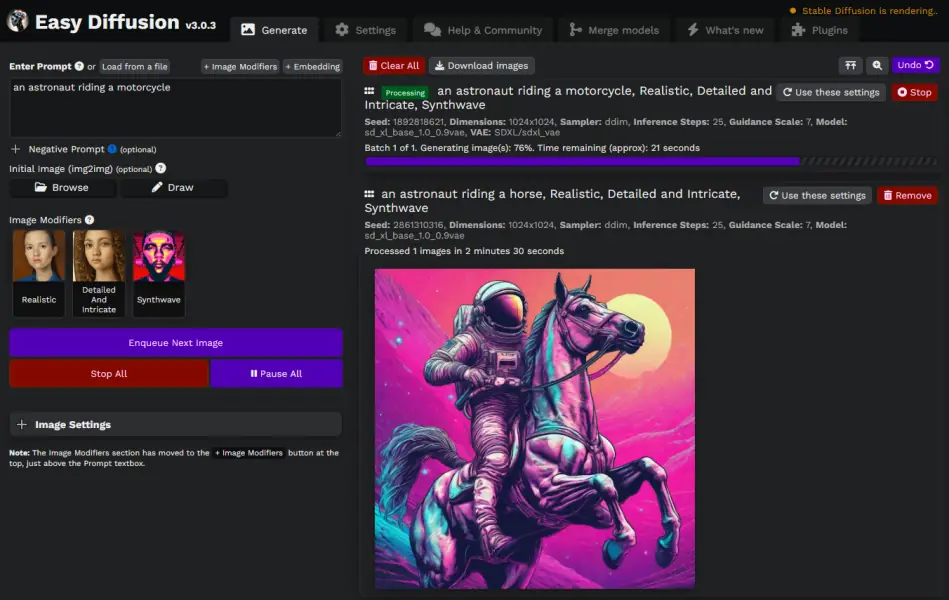

# Easy Diffusion

Easy Diffusion is an easy, 1-click way to create beautiful artwork on your own PC using AI, with no tech knowledge needed. Run the installer, enter a text or image prompt, and see the generated image.

Everything runs on your own PC and nothing is uploaded to the cloud.

[Download](https://github.com/easydiffusion/easydiffusion#installation){ .md-button .md-button--primary }
[Learn more](https://github.com/easydiffusion/easydiffusion#features){ .md-button }

<figure class="ed-hero__figure">
  
</figure>

## New here? Start with these

1. [Install Easy Diffusion](./installation.md)
2. [How to use](./getting-started/how-to-use.md): make your first images
3. [Writing prompts](./getting-started/writing-prompts.md): how to describe what you want
4. [Image modifiers](./getting-started/image-modifiers.md): one-click styles to add to your prompts

When you feel comfortable, browse the rest of [Getting started](./getting-started/how-to-use.md), especially the [UI reference](./getting-started/ui-reference.md), which explains every control in the interface.

## Going further

* [Models and engines](./docs/models/engines.md): install custom models, switch between Easy Diffusion's AI engines, and use newer models like [Flux and SD3](./docs/models/flux-and-newer-models.md)
* [Image settings](./docs/techniques/samplers.md): samplers, schedulers, LoRAs, embeddings, ControlNet and more
* [Saving images and metadata](./docs/saving/saving-and-metadata.md): auto-save, bulk download, and restoring a task from an image
* [Sharing your instance](./docs/saving/sharing-your-instance.md): let other people use your Easy Diffusion
* [Rendering performance](./docs/performance/rendering-performance.md): get the most out of your hardware

## Blog

Follow along with the development of Easy Diffusion on the [blog](blog/index.md), where worklogs are posted regularly.

## Help

If something does not work, start with [Troubleshooting](./docs/troubleshooting.md). You can also ask on the [Discord server](https://discord.com/invite/u9yhsFmEkB) or [open an issue on GitHub](https://github.com/easydiffusion/easydiffusion/issues).

## Disclaimer

The authors of this project are not responsible for any content generated using this interface.

The [license of this software](https://github.com/easydiffusion/easydiffusion/blob/main/LICENSE) forbids you from sharing any content that violates any laws, produce any harm to a person, disseminate any personal information that would be meant for harm, spread misinformation, or target vulnerable groups. For the full list of restrictions please read the license. You agree to these terms by using this software.
